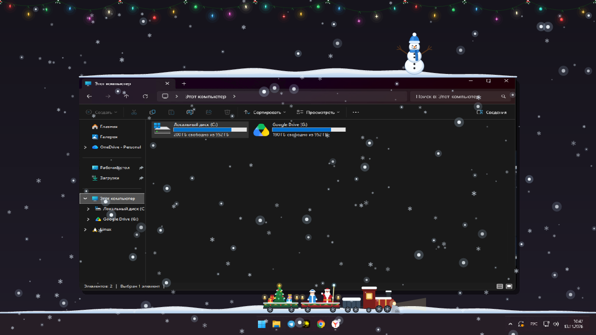
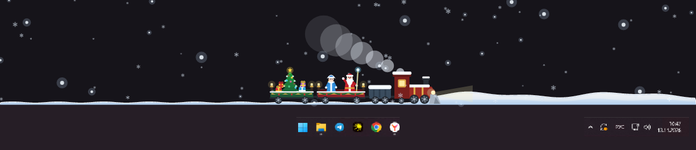
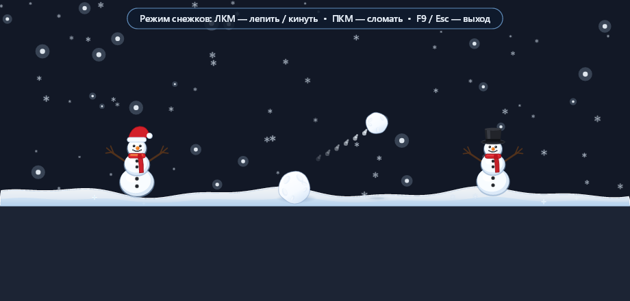
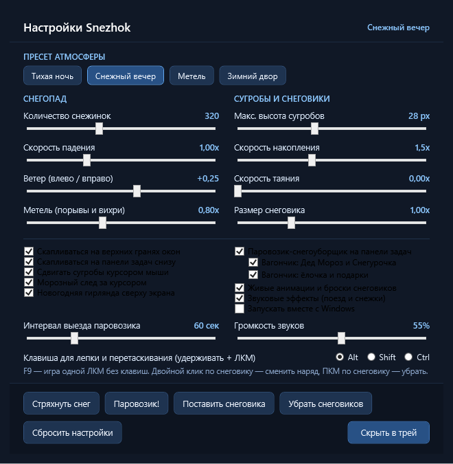

# Snezhok (Снежок) ❄️

Атмосферный, живой и интерактивный снег на рабочий стол Windows с физикой накопления сугробов на окнах, рождественской гирляндой, новогодним поездом и лепкой снежков.



---

## 🌟 Ключевые особенности

### 1. Физический снегопад и живая метель
- **Глубина и параллакс:** хлопья снега распределены по трем слоям глубины с разной скоростью падения, размером и резкостью.
- **Интерактивный ветер:** плавные порывы ветра и закручивание снежинок вокруг курсора мыши.
- **Поддержка нескольких мониторов:** корректная работа на любой конфигурации экранов с учётом Per-Monitor DPI.

### 2. Реалистичные сугробы на окнах и панели задач
- Снег плавно ложится на заголовок любого открытого окна и верхнюю кромку панели задач.
- Поверхность сугробов имеет естественную форму дюн с плавными гребнями и мерцающими на свету кристаллами льда.
- Возможность включения постепенного таяния снега.

### 3. Новогодняя органичная гирлянда


- Расположена вдоль верхней кромки экрана в виде естественных провисающих волн разной длины и глубины.
- В точках крепления — пушистые еловые лапки с инеем и алые зимние ягодки.
- Лампочки спускаются каскадной бахромой на разную высоту и слегка покачиваются на ветру.
- Три типа ламп: классические винтажные капли C9, матовые круглые фонарики и сияющие гранёные звёздочки.
- Окно оверлея полностью прозрачно для кликов (`WS_EX_TRANSPARENT`), поэтому гирлянда не мешает работе с вкладками браузера и кнопками окон.

### 4. Праздничный паровозик-снегоуборщик


- Периодически проезжает по панели задач и очищает снег вращающимся роторным шнеком.
- В составе поезда:
  - **Локомотив:** прожектор, пар из трубы, анимация дышла колёс и настоящий паровозный гудок.
  - **Вагон с Дедом Морозом и Снегурочкой:** Дед Мороз с посохом и Снегурочка в лазурной шубке.
  - **Вагон с новогодней ёлкой:** украшенная светящаяся ель с сияющей верхушкой и коробками подарков.
- Каждый вагон можно включать или отключать отдельно в настройках.

### 5. Интерактивные снежки и снеговики


- **Скатывание снежка:** зажмите `Alt + ЛКМ` (клавишу можно изменить на `Shift` или `Ctrl`) и катите ком по снегу. Снежок увеличивается в размере, отбрасывает мягкую тень и оставляет колею.
- **Бросок:** отпустите кнопку мыши с ускорением — снежок полетит по траектории, отскочит от окон или эффектно разобьётся на осколки.
- **Лепка снеговика:** соберите три снежка друг на друга, чтобы слепить снеговика. Снеговики дышат, моргают и реагируют на клик мыши, меняя шапочки и шарфы.

### 6. Уютное звуковое сопровождение
- Реалистичные звуки: хруст снега, гудок поезда, шум снегоуборочного шнека и разбивание снежков.
- Полная регулировка громкости в настройках или отключение звука в один клик.

---

## ⚙️ Настройки и пресеты


В программе предусмотрены готовые профили атмосферы:
- **«Снежный вечер»** — умеренный уютный снегопад, сугробы, паровозик и гирлянда.
- **«Тихая ночь»** — редкий нежный снег, медленное таяние, без звука и гирлянды.
- **«Метель»** — плотный снегопад с сильными порывами ветра и быстрым накоплением сугробов.
- **«Зимний двор»** — идеальный режим для лепки снежков и снеговиков.

---

## ⌨️ Управление

| Сочетание клавиш | Описание действия |
|---|---|
| **`F9`** | Включение / выключение интерактивного режима снежков |
| **`Alt + ЛКМ`** | Скатывание снежка по поверхности снега |
| **Клик по снеговику** | Переодеть снеговика (сменить ведро/цилиндр/колпак/шарф) |
| **ПКМ по иконке в трее** | Главное меню (пресеты, звук, гирлянда, ручной вызов поезда) |
| **Двойной клик по трею** | Открыть окно детальных настроек |

---

## 💾 Конфигурация и файл настроек

Все пользовательские параметры сохраняются в стандартном JSON-файле в профиле пользователя Windows:

- **Расположение:** `%APPDATA%\Snezhok\settings.json`  
  *(полный путь: `C:\Users\<Имя_Пользователя>\AppData\Roaming\Snezhok\settings.json`)*
- **Быстрый переход к папке:** нажмите сочетание клавиш **`Win + R`**, вставьте `%APPDATA%\Snezhok` и нажмите **Enter**.

> **Преимущество:** настройки не привязаны к папке с программой. Вы можете переносить или обновлять `Snezhok.exe` — ваши персональные настройки не сбросятся.

### Основные параметры в `settings.json`

| Параметр | Тип | Назначение |
|---|---|---|
| `SnowflakeCount` | число | Количество снежинок на экране (20 .. 800) |
| `FallSpeed` | число | Множитель скорости падения снега (0.25 .. 3.0) |
| `WindStrength` | число | Направление и сила ветра (-2.0 .. +2.0) |
| `BlizzardIntensity` | число | Интенсивность порывов метели (0.0 .. 2.0) |
| `MaxDriftHeight` | число | Максимальная высота сугробов в пикселях (4 .. 65) |
| `AccumulationRate` | число | Скорость накопления снега (0.2 .. 4.0) |
| `MeltRate` | число | Скорость постепенного таяния сугробов (0.0 .. 1.5) |
| `GarlandEnabled` | bool | Включение рождественской гирлянды сверху экрана |
| `SnowplowEnabled` | bool | Паровозик-снегоуборщик на панели задач |
| `TrainSantaWagon` | bool | Вагончик с Дедом Морозом и Снегурочкой |
| `TrainTreeWagon` | bool | Вагончик с нарядной ёлочкой и подарками |
| `SnowplowIntervalSeconds` | число | Интервал выезда поезда в секундах (15 .. 300) |
| `SnowmanAnimations` | bool | Живые анимации снеговиков (дыхание, моргание) |
| `SnowmanScale` | число | Размер снеговиков (0.6 .. 2.0) |
| `SoundEnabled` | bool | Звуковые эффекты (гудок поезда, хруст снега) |
| `SoundVolume` | число | Громкость звуков (0.0 .. 1.0) |
| `SnowballModifier` | строка | Клавиша-модификатор для лепки снежка (`"Alt"`, `"Shift"`, `"Ctrl"`) |

### Как сбросить настройки
- **Через интерфейс:** в окне настроек нажать кнопку **«Сбросить настройки»**.
- **Вручную:** удалить файл `settings.json` — при следующем старте программа автоматически восстановит значения по умолчанию.

### Автозапуск Windows
При включении опции «Запускать вместе с Windows» программа создаёт запись в реестре текущего пользователя:  
`HKCU\Software\Microsoft\Windows\CurrentVersion\Run` → ключ `Snezhok`. При удалении программы через `Uninstall.exe` или отключении галочки в меню запись автоматически удаляется.

---

## 🚀 Установка и запуск

Готовые сборки доступны в двух вариантах:
1. **Портативная версия (`Snezhok.exe`)** — один исполняемый файл. Не требует прав администратора и установки .NET (всё вшито внутрь). Запускается из любой папки.
2. **Установщик (`SnezhokSetup.exe`)** — классический инсталлятор на русском языке. Устанавливает программу в систему, создаёт ярлыки на рабочем столе и в меню «Пуск», добавляет опцию автозапуска и обеспечивает чистое удаление через систему.

---

## 🔨 Сборка из исходников

### Требования к окружению
- Операционная система: **Windows 10 / 11 (x64)**
- Установленный [.NET 8.0 SDK](https://dotnet.microsoft.com/download/dotnet/8.0)

### Шаги сборки:
```bash
# Клонирование репозитория
git clone https://github.com/ВАШ_ЛОГИН/snezhok.git
cd snezhok

# Сборка проекта
dotnet build -c Release

# Публикация единого автономного файла (Single-File .exe)
dotnet publish -c Release -r win-x64 --self-contained true `
    -p:PublishSingleFile=true `
    -p:IncludeNativeLibrariesForSelfExtract=true `
    -p:EnableCompressionInSingleFile=true `
    -p:DebugType=None -p:DebugSymbols=false `
    -o ./publish
```

---

## 📁 Структура проекта

```
Snow/
├── Assets/              # Иконка snezhok.ico, встроенные звуки WAV, скриншоты
├── Models/              # SnowSettings.cs (хранение настроек в JSON, пресеты)
├── Native/              # Win32.cs (P/Invoke вызовы user32, gdi32, стили окон)
├── Overlay/             # OverlayWindow.cs, OverlayManager.cs (прозрачные Skia-оверлеи)
├── Rendering/           # SnowRenderer.cs (рендер хлопьев, сугробов, гирлянды, поезда через SkiaSharp)
├── Services/            # SnowAudioService.cs (аудио), AutostartService.cs (реестр автозапуска)
├── Simulation/          # SnowSimulation.cs (физика снегопада, кинематика поезда, снежки, снеговики)
├── Tracking/            # WindowSurfaceTracker.cs (отслеживание окон и панели задач)
├── UI/                  # SettingsWindow.xaml (интерфейс настроек WPF), TrayIconHelper.cs
├── app.manifest         # Манифест с поддержкой Per-Monitor DPI Aware v2
└── SnowDesktop.csproj   # Файл проекта .NET 8 WPF
```

---

## 📄 Лицензия
Проект распространяется под свободной лицензией **MIT License**.
